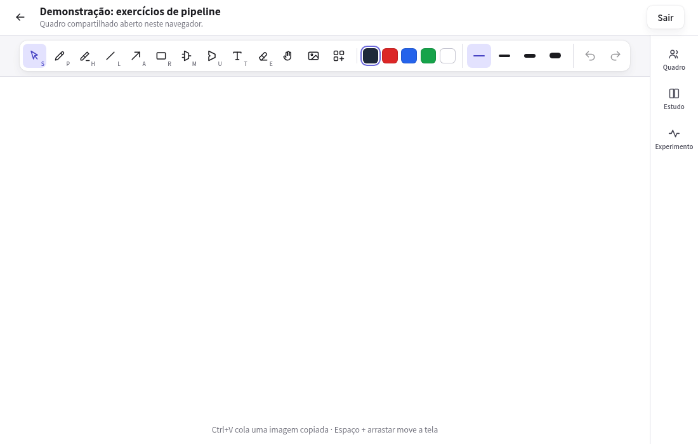

# Quadro colaborativo para estudos de Arquitetura de Computadores



Captura local com dois perfis de navegador e dados de demonstração.

## Acesso

- [Aplicação no Render](https://project3-2026b-arthurmfroes.onrender.com/)

A instância gratuita pode demorar para responder depois de um período sem uso.

## Desenvolvedor(a)

Arthur Moro Fróes - Sistemas de Informação

## Proposta

Evolução de uma aplicação web colaborativa de estudos de Arquitetura de Computadores por meio da integração da biblioteca Yjs, explorando o uso de CRDTs para sincronização, tratamento de edições concorrentes e estratégias de distribuição do estado entre múltiplos usuários.

A ideia é que várias pessoas possam resolver exercícios de datapath e outros conteúdos da disciplina no mesmo quadro. Cada navegador mantém uma cópia do documento e troca alterações com os outros participantes. O servidor cuida das contas, do acesso aos quadros, dos arquivos de imagem e da persistência.

Quis continuar explorando sistemas distribuídos, como no projeto 2, mas colocando os navegadores como participantes do sistema. O objetivo da distribuição entre peers é reduzir os envios repetidos para um servidor pequeno.

### Funcionalidades

- Cadastro, login e sessão de usuário.
- Vários quadros, cada um com link e membros próprios.
- Pedido, aprovação e revogação de acesso ao quadro.
- Desenho compartilhado com caneta, marca-texto, formas, setas, texto e imagens.
- Cursores e prévias de desenho dos outros participantes.
- Sincronização P2P e conciliação de alterações concorrentes com Yjs.
- Cópia local no IndexedDB e recuperação das edições ao reabrir o navegador.
- Sorteio de um representante para enviar lotes de alterações ao servidor.
- Painel de experimento com sorteios, tentativas de envio, persistência e confirmações por participante.

## Desenvolvimento

### Processo

De maneira semelhante ao projeto 2, usei o OpenSpec para organizar as especificações e a construção com agentes da família GPT. Minha participação ficou principalmente na definição do comportamento, nas decisões sobre a distribuição e nas iterações depois de usar o sistema e observar os resultados.

A base foi um quadro que já existia para estudar Arquitetura de Computadores. Ele tinha as ferramentas de desenho e os diagramas, mas concentrava a comunicação em um servidor e trabalhava com um quadro único. Essa versão de referência ficou na pasta `whiteboard/`. A aplicação atual usa Node e acrescenta contas, quadros separados, permissões, armazenamento local e sincronização entre navegadores.

Uma das partes que precisei entender melhor foi o que significa ter várias cópias do mesmo quadro. Não adiantava só enviar o estado inteiro de uma tela para outra, porque duas pessoas podem editar ao mesmo tempo ou ficar sem conexão. Usei o Yjs para representar o documento e conciliar essas alterações.

Depois veio a questão do servidor. Se todos os participantes mandassem as mesmas alterações para ele, distribuir o documento por P2P ainda deixaria bastante trabalho repetido no backend. A solução foi sortear um representante entre os participantes disponíveis. Ele envia os lotes e compartilha a confirmação de persistência com os demais. Se falhar, outro pode assumir. Foi importante separar isso da conciliação do documento, o representante não escolhe qual quadro está certo. Essa parte continua sendo responsabilidade do Yjs em cada réplica.

Também precisei de uma forma de enxergar o que estava acontecendo. O painel Experimento mostra o representante observado por cada aba, os números sorteados, as tentativas de envio e quem recebeu a confirmação. Achei mais útil ter essas evidências do que olhar duas telas iguais e concluir que tudo foi salvo. Uma edição pode ter chegado pelo P2P e ainda não estar persistida no servidor.

Os testes incluíram perfis de navegador separados, edições concorrentes, perda de conexão, troca de representante e recuperação depois de reiniciar o servidor. Na hospedagem, escolhi o Render porque o Railway estava fora do ar.


### Trechos de código

#### Conexão entre os peers

O navegador primeiro pede ao servidor as informações da sala. Essa rota verifica a sessão e se o usuário é membro do quadro. Depois é criado o provider do WebRTC:

```js
const signalingUrl = new URL('/api/signaling', locationHref);
signalingUrl.protocol = signalingUrl.protocol === 'https:' ? 'wss:' : 'ws:';
const nextProvider = new WebrtcProvider(access.topic, doc, {
  signaling: [signalingUrl.toString()],
  password: access.password,
  maxConns: 8,
  filterBcConns: true,
});
```

O `doc` é o documento Yjs daquele navegador. O `access.topic` identifica a sala e o servidor fornece a mesma senha aos membros autorizados. A sinalização ajuda os navegadores a encontrar os pares e negociar a conexão. Depois de estabelecida, as alterações podem circular pelo canal WebRTC. O servidor de sinalização não precisa retransmitir cada traço do desenho.

O limite de oito é de conexões diretas por provider, não de usuários permitidos no quadro. Não é necessário que cada participante esteja conectado diretamente a todos os outros para que as alterações se propaguem. O código está em [`src/client/board-session.js`](src/client/board-session.js).

#### Conciliação das cópias do quadro

A parte principal dessa conciliação vem do próprio Yjs. Cada navegador possui um `Y.Doc`, e o provider liga o transporte P2P a esse documento. No protocolo usado pelo `y-webrtc`, uma mensagem de atualização acaba sendo aplicada assim:

```js
Y.applyUpdate(doc, decoding.readVarUint8Array(decoder), transactionOrigin)
```

Esse trecho é da dependência [`y-protocols`, em `sync.js`](https://github.com/yjs/y-protocols/blob/master/sync.js). Não implementei um algoritmo de merge próprio. Na recuperação pelo nosso servidor, a aplicação usa o mesmo mecanismo do Yjs:

```js
const remote = decodeBytes(data.update);
```

```js
Y.applyUpdate(doc, remote, SERVER_ORIGIN);
```

Os dois recortes estão em [`src/client/room-persistence.js`](src/client/room-persistence.js), com verificações de recibo e instrumentação entre eles. O update é incorporado ao documento existente, em vez de substituir o quadro inteiro. O Yjs consegue lidar com a ordem de chegada e com o recebimento repetido das alterações. Se as réplicas receberem o mesmo conjunto de updates, elas convergem para o mesmo estado.

Isso não quer dizer que tudo que duas pessoas tentaram fazer será mantido. Se uma move o retângulo e outra muda a cor, são campos diferentes e as duas alterações podem sobreviver. Se as duas mudam a mesma posição ao mesmo tempo, o Yjs resolve o conflito de forma determinística. Não é o servidor nem o representante que decide manualmente qual posição vence.

#### Sorteio do representante e persistência eventual

Cada participante cria uma candidatura com um número aleatório de 32 bits e uma identificação de geração. O número pode ir de zero a 4.294.967.295:

```js
random = () => crypto.getRandomValues(new Uint32Array(1))[0],
```

Cada aba observa os candidatos que conhece e aplica a mesma regra de escolha:

```js
const available = !paused && !revoked && now() >= eligibleAt ? [candidate] : [];
if (peerEnabled) for (const value of candidates.values()) {
  if (now() - value.seen < times.staleMs && !rejected.has(value.candidate.token)) available.push(value.candidate);
}
available.sort((a, b) => a.priority - b.priority || a.id.localeCompare(b.id));
const next = available[0]?.id ?? null;
```

O menor número vence. Se houver empate, o ID da aba desempata. A candidatura é renovada a cada 30 segundos. No funcionamento normal de um grupo conectado, o representante envia as diferenças em lotes de um segundo. O servidor confirma depois do COMMIT no SQLite e o recibo assinado é compartilhado pelo P2P. Cada participante verifica a assinatura e quais alterações foram cobertas antes de retirá-las da lista de pendências.

Se o envio falha ou o ACK não chega no prazo de quatro segundos, a candidatura entra em espera e outro participante pode assumir. Uma edição sem confirmação por oito segundos também pode seguir pela recuperação direta. A ideia é que o servidor alcance o estado que os peers já estão compartilhando, desde que volte a existir um caminho de comunicação e uma réplica ainda tenha as alterações.

Achei importante não tratar isso como uma eleição global garantida. Em uma partição, dois grupos podem observar candidatos diferentes e escolher representantes diferentes. Os updates continuam sendo conciliados pelo Yjs quando a comunicação volta. O sorteio organiza o envio ao servidor. O mecanismo está em [`src/client/room-persistence.js`](src/client/room-persistence.js), e a persistência e os recibos estão em [`src/server/room-persistence.js`](src/server/room-persistence.js).

## Tecnologias

### Linguagens e afins

- HTML, CSS e JavaScript no frontend, com Canvas para o quadro.
- Node.js 24 no backend, usando o módulo HTTP do próprio Node.
- Yjs para o documento compartilhado e a conciliação das alterações.
- y-webrtc e WebRTC para comunicação entre peers.
- WebSocket, com a biblioteca `ws`, para sinalização e diagnóstico.
- IndexedDB, integrado pelo y-indexeddb, para a cópia local do quadro.
- SQLite e better-sqlite3 para contas, acesso, updates, checkpoints e histórico.
- Argon2id para o hash das senhas e Ed25519 para os recibos de persistência.
- Render para hospedagem.

### Autenticação e autorização

O usuário cria uma conta com nome e senha. A senha é armazenada como hash Argon2id com salt, e o login gera um token aleatório de sessão. O navegador recebe esse token em um cookie `HttpOnly`, `SameSite=Lax` e `Secure` quando a conexão é HTTPS. No banco fica somente o hash do token. A sessão tem validade de sete dias.

Estar autenticado não dá acesso automático a todos os quadros. Cada quadro tem sua lista de membros. Quem está fora pode pedir acesso, e um membro atual pode aceitar o pedido. As rotas de conteúdo, imagem, persistência e sinalização verificam essa associação. Um membro também pode revogar o acesso de outro, inclusive de quem criou o quadro.

A revogação troca a versão da sala P2P e fecha as conexões antigas dos clientes que seguem o protocolo. Ela impede acesso futuro, mas não apaga uma cópia do conteúdo que o participante já recebeu.

### Ambiente de desenvolvimento

- VS Code.
- Codex e agentes da família GPT.
- OpenSpec para especificação e acompanhamento das mudanças.
- Git e GitHub.
- Chrome/Chromium com perfis separados para observar a colaboração.

## Executar em desenvolvimento

Com Node.js 24.21.0 e npm, na raiz do repositório:

```sh
npm ci
npm start
```

O `npm start` gera o bundle do cliente antes de iniciar o servidor. Abra **http://localhost:3000**. Para restringir o acesso à própria máquina, use `HOST=127.0.0.1 npm start`.

O SQLite fica em `data/whiteboard.sqlite` e as imagens em `data/assets/`. Para os testes iniciais de servidor:

```sh
npm run smoke
```

Os detalhes de hospedagem estão em [docs/render-deployment.md](docs/render-deployment.md). O roteiro de uso e experimentos está em [docs/demo-t3.md](docs/demo-t3.md), e o funcionamento do representante está em [docs/elected-persistence.md](docs/elected-persistence.md).

## Referências e créditos
- Quadro de referência em [`whiteboard/`](whiteboard/), utilizado como base para as ferramentas e os materiais de Arquitetura de Computadores. A comparação está em [docs/feature-parity.md](docs/feature-parity.md).
- [Yjs](https://docs.yjs.dev/) e [API de updates](https://docs.yjs.dev/api/document-updates).
- [y-webrtc](https://github.com/yjs/y-webrtc) e [y-protocols](https://github.com/yjs/y-protocols).
- [WebRTC na MDN](https://developer.mozilla.org/en-US/docs/Web/API/WebRTC_API).
- [better-sqlite3](https://github.com/WiseLibs/better-sqlite3) e [node-argon2](https://github.com/ranisalt/node-argon2).
- [OpenSpec](https://github.com/Fission-AI/OpenSpec), usado para organizar o desenvolvimento com agentes.
- [Render](https://render.com/docs), usado na hospedagem.
- Codex e modelos da família GPT, utilizados no planejamento, na implementação e nos testes.

---

Projeto entregue para a disciplina de [Desenvolvimento de Software para a Web](http://github.com/andreainfufsm/elc1090-2026b) em 2026b.
